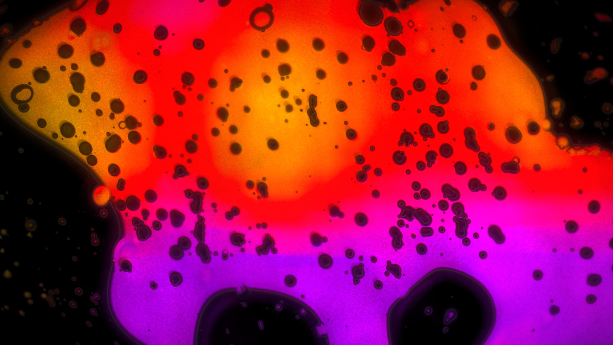
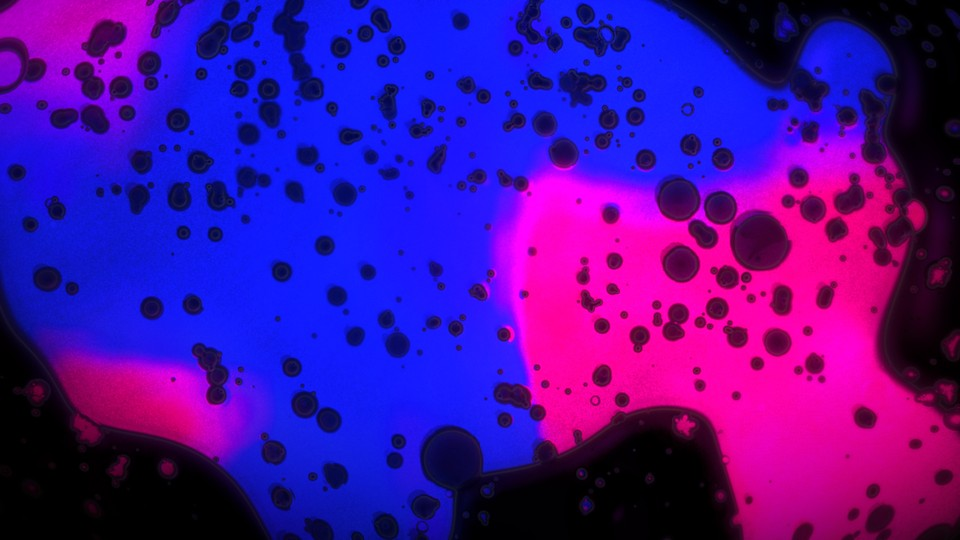
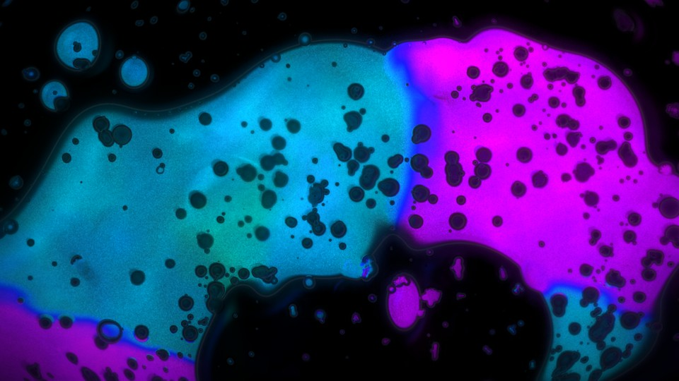
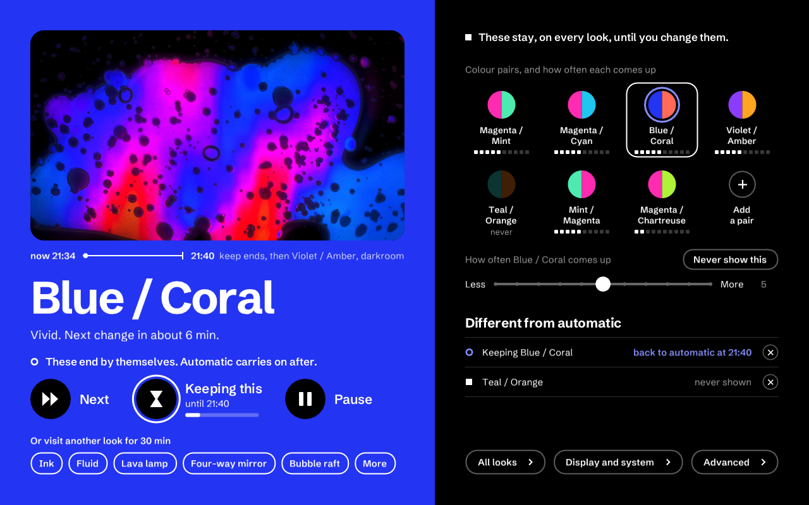

# Fluid Wallpaper

A live wallpaper for Windows: slow oil, ink and fluid simulations drawn behind your desktop icons with Direct3D 12.
It changes its colours and its look by itself over minutes, pauses while a game or a fullscreen window covers the
desktop, and works with Windows HDR on or off.

One exe, no runtime to install. It keeps itself up to date from this page.



<p>
  
  
</p>

Frames of the default oil look as the installer ships it, a minute or so apart.

## Install

**[Download FluidWallpaper-Setup-2026.11.23.exe](https://github.com/Nickoo321/fluid-wallpaper/raw/main/release/FluidWallpaper-Setup-2026.11.23.exe)**
(2.1 MB) and run it. No admin rights are needed. The same package as a zip and the SHA-256 sums are in
[`release/`](release).

- Windows 10 or 11, 64-bit, and a graphics card with DirectX 12.
- It starts dark for about the first minute while the oil builds up.
- The Setup is not code-signed, so SmartScreen says "Windows protected your PC": click **More info**, then
  **Run anyway**. (Or download the `.zip`, extract all of it and double-click `Install.cmd`.)
- It installs for the current user only, to `%LOCALAPPDATA%\Programs\FluidWallpaper`. Settings live in
  `%APPDATA%\FluidWallpaper`. Setup asks whether it should start with Windows.

**On / off:** the "Fluid Wallpaper on-off" shortcut on the desktop, or the tray icon -> Exit.
**Next colours:** the "Fluid Wallpaper next" shortcut, or the tray menu. The slow shift to the next pair of colours
starts right away (first new colour after about half a minute).
**Settings:** the tray icon -> Settings, or the Fluid Wallpaper entry in the Start menu while it runs (see
[Settings](#settings)).
**Uninstall:** Windows Settings -> Apps -> Fluid Wallpaper, or the Start menu entry. It asks whether to delete your
settings too.
**Updates:** from version 2026.11.21 on it updates itself. At most once a day (when you sign in to Windows, or turn
the wallpaper on with its shortcut) it looks at [`release/`](release) here; when a newer version is there it downloads
it, checks its SHA-256 and installs it without asking. Your settings are kept. It waits while a game or film fills
the screen. To switch that off, create an empty file named `no-auto-update.txt` in `%APPDATA%\FluidWallpaper`.
A copy older than 2026.11.21 does not do this: run the newer Setup over it once.

## Settings



The window opens on the Home screen, which has two sides:

- **The colour side** (left, in the colours on screen) holds what ends by itself: **Next**, **Keep this** (holds the
  colours for 30 minutes), **Pause** (until you resume), and a 30-minute visit to another look such as Ink or Fluid.
  After each one the automatic mode carries on.
- **The black side** (right) holds what is kept until you change it: the colour pairs and how often each one comes up,
  **Never show this**, **Add a pair** (pick two hues), and a list of everything that is now different from automatic,
  each line with an X that undoes it.
- **All looks** rates every pair and look and can show any of them next. **Display and system** has the frame rate,
  the pauses for fullscreen and maximized windows, the second monitor and starting with Windows.
- **Advanced** is the earlier window, with every setting it had.

## Privacy

The wallpaper itself never uses the network. The update check downloads a short list, and a new version when there is
one, from this repository; it sends nothing about you or your PC. The log files (`FluidWallpaper.log` and `update.log`
in `%APPDATA%\FluidWallpaper`) stay on your PC.
When the wallpaper pauses for a fullscreen program, the log names that program's exe (never its window title).

## Build from source

Needs Visual Studio 2022 Build Tools (the C++ workload, which brings CMake and Ninja) and the Windows SDK.

```bat
build.bat
```

That builds `build\FluidWallpaper.exe` (static CRT, system DLLs only). The same CMake project also builds three
small stand-alone proofs of concept: `OilWallpaper`, `AcidWallpaper` and `Ink3DWallpaper`.

Useful switches: `--console` (a diagnostics console), `--stats`, `--hdr on|off`, and `--shot file.png` (render one
frame without a window and exit; `--shot-delay N` seconds of simulation first).

Configuration is `%APPDATA%\FluidWallpaper\settings.ini`. The Settings window writes it live; a hand-edited file is
read at the next start. The settings, look files and presets a fresh install starts with are in `tools\installer\data`.

### Build the installer

```powershell
tools\installer\build-installer.ps1 -Exe build\FluidWallpaper.exe -Data tools\installer\data -Version 1.0.0
```

It writes `dist\FluidWallpaper-<version>.zip` and `dist\FluidWallpaper-Setup-<version>.exe`. `tools\installer\data`
is the default settings, looks and presets a fresh install starts with. See `tools\installer\README.md`.

## Add a feature

The whole source is in this repository under the MIT licence, and it is the source of the Setup in `release/`. You,
or an AI coding agent working for you, can change it and build your own copy.

Two files hold what you need. Point your AI at them first:

- **[AGENTS.md](AGENTS.md)**: how the code is put together, where each thing is, how to check a change without a
  window, step-by-step recipes (add a setting, get a value into a shader, add a look without code), and the rules
  that keep the picture right.
- **[HOW-TO-PUSH.md](HOW-TO-PUSH.md)**: how to send the change back: fork, branch, pull request, and what never to
  push.

In short:

1. Fork or clone this repository and build it (see [Build from source](#build-from-source)).
2. Turn the installed wallpaper off with its on-off shortcut, then run your `build\FluidWallpaper.exe`. Only one copy
   runs at a time, and your build uses the same settings in `%APPDATA%\FluidWallpaper`.
3. A new setting is off by default, and with it off the picture is exactly what it was before.
4. To share the feature, open a pull request against `main`. One feature per request.

**Your build and the updates:** an installed copy updates itself. If you put your own exe into
`%LOCALAPPDATA%\Programs\FluidWallpaper`, the next published version replaces it. To keep your build, create the
empty file `no-auto-update.txt` in `%APPDATA%\FluidWallpaper`, or run your exe from the build folder and leave the
installed copy alone.

## Layout

- `src/` the wallpaper: `main.cpp` (app shell, tray, HDR detection, ini), `fluid.cpp` + `shaders.h` (simulation and
  rendering), `director.cpp` (the colour director), `cycle.cpp` (the look cycle), `ui/` (the Settings window).
- `src/third_party/imgui/` Dear ImGui, unchanged. `src/ui/fonts/` the Schibsted Grotesk font files and their licence.
- `src_oil/`, `src_acid/`, `src_ink3d/` the proofs of concept.
- `tools/installer/` the installer scripts and `data/`, the default settings, look files and presets.
- `release/` the built installer.

## Licence and credits

MIT, see [LICENSE](LICENSE).

The fluid simulation started as a C++ / Direct3D 12 port of
[WebGL Fluid Simulation](https://github.com/PavelDoGreat/WebGL-Fluid-Simulation) by Pavel Dobryakov (MIT).
The Settings window uses [Dear ImGui](https://github.com/ocornut/imgui) by Omar Cornut (MIT).
Its typeface is [Schibsted Grotesk](https://github.com/schibsted/schibsted-grotesk) by The Schibsted-Grotesk Project
Authors (SIL Open Font License 1.1).
Full notices: [THIRD-PARTY-NOTICES.md](THIRD-PARTY-NOTICES.md).

